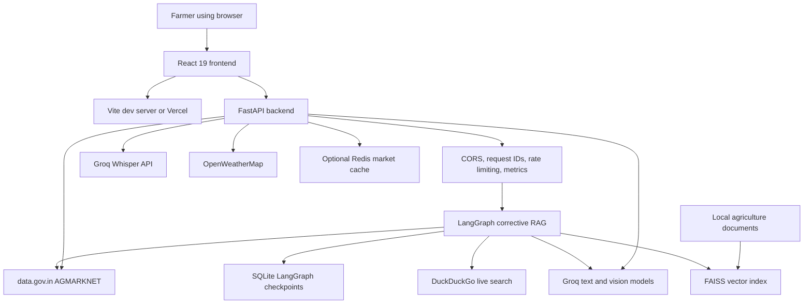
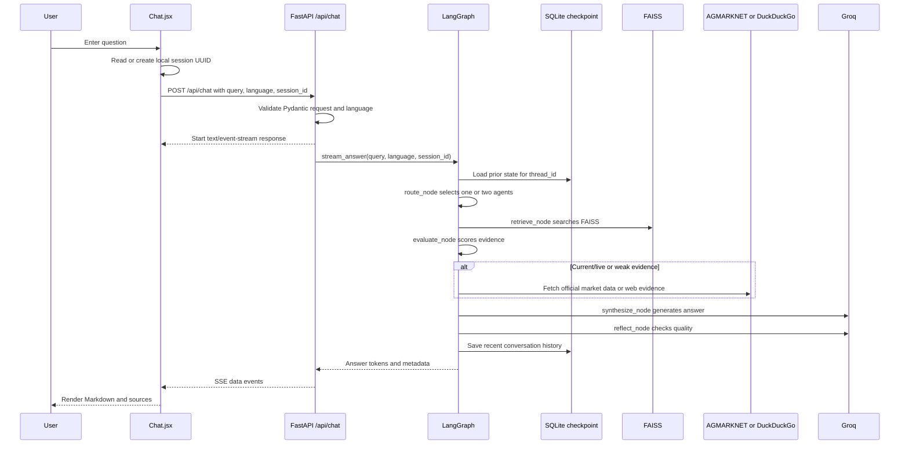
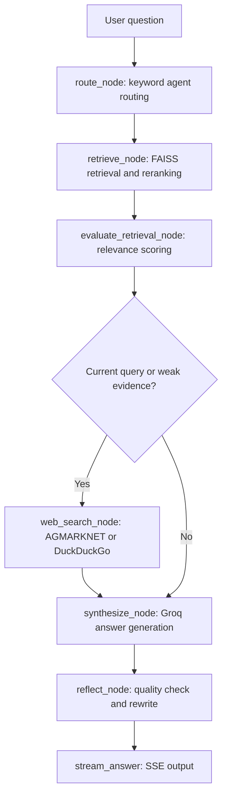
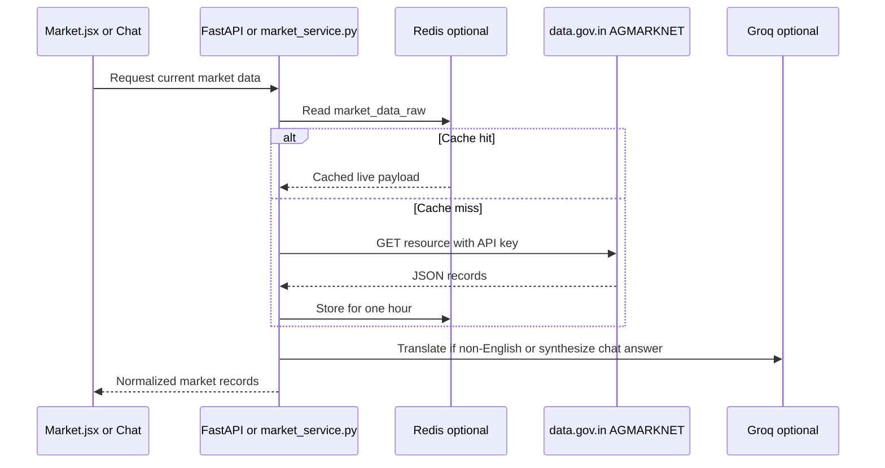
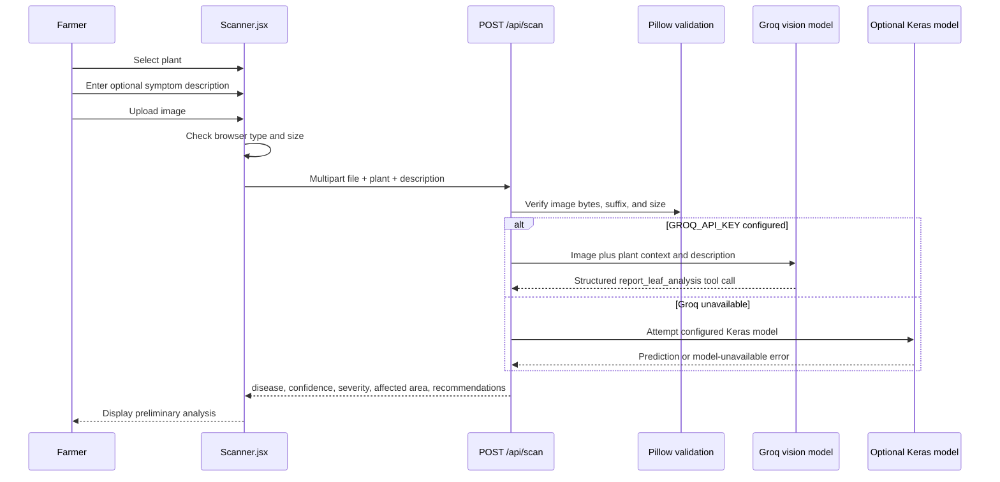

# AgriMitra AI Pro
## Complete Technical Architecture and Interview Guide

> This document describes the implementation currently present in the repository. It distinguishes working integrations from static content, optional capabilities, and incomplete production features.

## 1. Executive Summary

AgriMitra AI Pro is a full-stack agricultural assistant for Indian farmers. It provides a React/Vite web interface and a FastAPI backend. The main capabilities are:

- Agricultural question answering through a LangGraph corrective-RAG workflow.
- Retrieval from a local FAISS index built from agriculture documents.
- Groq-based answer generation, translation, weather advisory generation, and leaf-image analysis.
- Live mandi-price retrieval from data.gov.in / AGMARKNET.
- Live weather retrieval from OpenWeatherMap.
- A maintained government-scheme catalog with official links.
- Voice transcription through the Groq Whisper API.
- Conversation memory through LangGraph SQLite checkpoints.

This is a functional full-stack prototype with real external integrations. It is not yet a complete production platform because authentication, farmer profiles, a verified custom disease model, comprehensive end-to-end testing, and strict service readiness are incomplete.

## 2. High-Level Architecture



## 3. Repository Structure

```text
agrimitraai/
├── README.md
├── PROJECT_TECHNICAL_GUIDE.md
├── ARCHITECTURE.md
├── AG_RIMITRA_CHANGELOG.md
├── MARKET_LIVE_DATA.md
├── .env.example
├── .gitignore
│
├── backend/
│   ├── main.py
│   ├── multi_rag.py
│   ├── market_service.py
│   ├── plant_disease_service.py
│   ├── schemes_data.py
│   ├── ingest.py
│   ├── requirements.txt
│   ├── Dockerfile
│   │
│   ├── data/
│   │   ├── docs/
│   │   │   ├── government_schemes.txt
│   │   │   └── weather_advisory.txt
│   │   └── states-and-districts.json
│   │
│   ├── faiss_index/
│   │   ├── index.faiss
│   │   └── index.pkl
│   │
│   ├── scripts/
│   │   └── train_plant_disease_model.py
│   │
│   └── tests/
│       ├── test_api.py
│       ├── test_ingest.py
│       ├── test_live_market_routing.py
│       ├── test_memory.py
│       └── test_router.py
│
└── frontend/
    ├── package.json
    ├── vite.config.js
    ├── Dockerfile
    ├── vercel.json
    ├── index.html
    │
    └── src/
        ├── main.jsx
        ├── App.jsx
        ├── index.css
        ├── translations.js
        └── components/
            ├── Layout.jsx
            ├── AgentGrid.jsx
            ├── Chat.jsx
            ├── Scanner.jsx
            ├── Market.jsx
            ├── Weather.jsx
            └── Schemes.jsx
```

### Important files

| File | Responsibility | Status |
|---|---|---|
| `frontend/src/main.jsx` | React bootstrap and BrowserRouter | Active |
| `frontend/src/App.jsx` | Frontend route definitions | Active |
| `frontend/src/components/Layout.jsx` | Sidebar, header, language selector | Active |
| `frontend/src/components/Chat.jsx` | Chat UI, SSE parsing, audio recording | Active |
| `frontend/src/components/Scanner.jsx` | Plant selection, notes, image upload, results | Active |
| `frontend/src/components/Market.jsx` | Live market UI | Active |
| `frontend/src/components/Weather.jsx` | Live weather UI | Active |
| `frontend/src/components/Schemes.jsx` | Scheme catalog UI | Active |
| `backend/main.py` | FastAPI app and most HTTP routes | Active |
| `backend/multi_rag.py` | LangGraph workflow, retrieval, memory, synthesis | Active |
| `backend/market_service.py` | Shared AGMARKNET client used by chat | Active |
| `backend/plant_disease_service.py` | Local model validation and inference path | Partially used |
| `backend/schemes_data.py` | Official scheme catalog | Active |
| `backend/ingest.py` | Builds FAISS index | Manual utility |
| `backend/scripts/train_plant_disease_model.py` | Training scaffold | Not executed in repository |
| `backend/faiss_index/` | Persisted vector search artifacts | Active runtime data |

## 4. Frontend Architecture

The frontend starts at `frontend/src/main.jsx`:

```text
StrictMode
  └── BrowserRouter
      └── App
          └── Layout
              └── Outlet route component
```

### Routes

| Route | Component | Purpose |
|---|---|---|
| `/` | `AgentGrid` | Shows available specialist agents |
| `/chat` | `Chat` | General agricultural chat |
| `/chat/:agentId` | `Chat` | Chat route associated with an agent ID |
| `/scanner` | `Scanner` | Leaf-image analysis |
| `/market` | `Market` | Live mandi-price display |
| `/weather` | `Weather` | Location-based weather and advisory |
| `/schemes` | `Schemes` | Government scheme catalog |

`frontend/vite.config.js` proxies `/api` and `/health` to the backend. In development the default backend target is `http://127.0.0.1:8000`, configurable with `VITE_BACKEND_URL`.

## 5. Backend Architecture

`backend/main.py` creates the FastAPI application and configures:

- Application lifespan handling.
- Optional Redis connection.
- CORS.
- Request IDs.
- Prometheus instrumentation.
- SlowAPI rate limiting.
- API routes.
- Static frontend serving when `frontend/dist` exists.

`backend/multi_rag.py` owns the chat workflow and is imported by `main.py`.

## 6. Complete Chat Data Flow



### Chat request

```json
{
  "query": "How do I treat rice blast?",
  "language": "en",
  "session_id": "browser-generated-uuid"
}
```

### Chat workflow



### Agent routing

Routing is keyword-based, not a trained classifier.

| Agent ID | Responsibility |
|---|---|
| `crop_advisor` | Crops, diseases, pests, fertilizers, cultivation |
| `market_analyst` | Prices, MSP, mandi, demand, storage |
| `schemes_expert` | Schemes, subsidies, eligibility, applications |
| `weather_analyst` | Rain, temperature, forecasts, climate risk |
| `leaf_scanner` | Leaf symptoms and disease-related questions |

## 7. RAG and Knowledge Base

### Ingestion flow

`backend/ingest.py`:

1. Reads `.txt` files from `backend/data/docs/`.
2. Also has PDF-loading support, although the current corpus contains text files only.
3. Splits documents into chunks of approximately 800 characters.
4. Uses 150-character overlap.
5. Creates embeddings with `all-MiniLM-L6-v2`.
6. Saves the FAISS index to `backend/faiss_index/`.

Current local text corpus:

- `government_schemes.txt`
- `weather_advisory.txt`

The local corpus is not authoritative for current market prices or current weather. Current facts must come from the live providers.

### Retrieval flow

1. `_init_components()` loads the embedding model and FAISS index lazily.
2. `agent_retrieve()` performs similarity search.
3. Local lexical overlap and source-agent matching are calculated.
4. Optional CrossEncoder reranking is available through `USE_CROSS_ENCODER`.
5. Results are deduplicated and limited.
6. `evaluate_retrieval_node()` uses Groq scoring when available.
7. If Groq grading fails, lexical scoring is used.

## 8. Live Market Data Flow



`backend/market_service.py` is used by current market questions inside the chat RAG flow. `backend/main.py` also contains a separate market implementation for `/api/market`; this duplication is a maintainability issue.

The market endpoint returns `503` if credentials or provider data are unavailable. It does not intentionally return fake market prices.

## 9. Weather Data Flow

`GET /api/weather/{state}/{city}?lang=en`:

1. Validates the language.
2. Requires `OPENWEATHER_API_KEY`.
3. Calls the OpenWeatherMap five-day forecast endpoint.
4. Extracts current temperature, humidity, wind, condition, and five forecast entries.
5. If Groq is configured, asks Groq for a JSON agricultural risk/advisory response based on the measured forecast.
6. If Groq is unavailable, returns the measured weather with a generic advisory limitation.
7. If the weather provider fails, returns `503`.

The fallback from `city,state,IN` to `city,IN` is a provider-query fallback, not mock weather data.

## 10. Leaf Scanner Flow



### Scanner fields

- `file`: JPEG, PNG, or WebP image, maximum 10 MB.
- `plant`: Required form field, 2–80 characters.
- `description`: Optional form field, maximum 1,200 characters.
- `lang`: Query parameter.

The frontend offers a plant list including rice, wheat, cotton, maize, tomato, chilli, groundnut, soybean, potato, brinjal, grapevine, and other plant.

The scanner result is a preliminary AI assessment. It is not a verified agronomic diagnosis. The selected plant is user-provided and is not independently validated.

### Local model training scaffold

`backend/scripts/train_plant_disease_model.py` contains a MobileNetV2 transfer-learning scaffold:

- Input size: 224 x 224
- Image normalization: divide by 255
- Training augmentation: rotation, shifts, brightness, horizontal flip
- Optimizer: Adam
- Loss: categorical cross-entropy
- Metric: accuracy
- Training epochs: 10
- Best checkpoint: `plant_disease_model.keras`
- Labels: `class_labels.json`

No dataset, trained weights, or measured model accuracy are included in the repository.

## 11. Government Schemes

`backend/schemes_data.py` contains a small static catalog with:

- Scheme name
- Category
- General description
- Eligibility summary
- Official link
- Source label

It is not a live scheme API. Current amounts, eligibility, deadlines, and rules should be verified on the linked official government portal.

## 12. Voice Transcription

`Chat.jsx` uses the browser `MediaRecorder` API. The recorded WebM audio is sent to:

```text
POST /api/transcribe
```

The backend forwards it to:

```text
https://api.groq.com/openai/v1/audio/transcriptions
```

using model `whisper-large-v3`.

The returned text is inserted into the chat input. Microphone permission is required. Audio is not intentionally persisted by the application.

## 13. API Reference

| Method | Endpoint | Input | Output | External dependency | Status |
|---|---|---|---|---|---|
| POST | `/api/chat` | JSON query, language, session ID | SSE answer and metadata | FAISS, Groq, AGMARKNET/DuckDuckGo, SQLite | Active |
| POST | `/api/transcribe` | Multipart audio file | `{ "text": "..." }` | Groq Whisper | Active, lightly tested |
| GET | `/api/agents` | `lang` query parameter | Agent metadata array | Optional Groq translation | Active |
| GET | `/api/geo-data` | None | Hardcoded geography object | None | Backend-only |
| GET | `/api/market` | `lang` query parameter | Normalized live records | AGMARKNET, optional Redis | Active |
| GET | `/api/schemes` | `lang` query parameter | Static scheme catalog | Optional Groq translation | Active |
| GET | `/api/weather/{state}/{city}` | State, city, language | Weather and advisory object | OpenWeatherMap, optional Groq | Active |
| POST | `/api/scan` | Multipart image, plant, description | Structured analysis | Groq vision or optional Keras | Active with limitations |
| GET | `/health` | None | Service status | None | Active |
| GET | `/ready` | None | Readiness object | None | Semantically incorrect |
| GET | `/metrics` | None | Prometheus metrics | Instrumentator | Exposed by library |

## 14. Persistence and Storage

### SQLite

Conversation state is stored using LangGraph's `AsyncSqliteSaver`.

Default path:

```text
backend/runtime/checkpoints.db
```

Configured with:

```env
CHECKPOINT_DB_PATH=./runtime/checkpoints.db
```

The stored state may include recent user questions, assistant answers, agent state, retrieval state, and metadata.

### Browser localStorage

The frontend stores only the browser session identifier:

```text
agrimitra_session_id
```

The actual conversation is stored server-side in SQLite.

### Redis

Redis is optional and stores the normalized raw market response under:

```text
market_data_raw
```

The expiry is one hour.

### Files

Uploaded leaf images and audio are processed in memory. The API does not intentionally save them to disk.

### FAISS

FAISS files contain vector index data and document metadata, not user accounts or transaction records.

## 15. Authentication and Security

Authentication is not implemented. There are no user accounts, passwords, JWTs, OAuth flows, roles, or protected business routes.

Implemented protections include:

- Pydantic request validation for chat.
- Supported-language validation.
- SlowAPI rate limiting.
- CORS middleware.
- Request IDs.
- Image size and content validation.
- Environment-based secrets.
- No intentional upload persistence.

Important security limitations:

1. Client-provided session IDs are not authenticated.
2. A user who obtains another session ID may be able to address that conversation.
3. Audio upload size and MIME validation are limited.
4. Some error paths expose raw exception text.
5. Redis TLS configuration disables certificate verification for `rediss://` connections.
6. FAISS uses `allow_dangerous_deserialization=True` and must only load trusted local files.
7. `/health` and `/ready` are public.
8. CORS includes development origins and allows credentials.

## 16. Environment Variables

Use `backend/.env.example` as the template. Never commit `backend/.env` or real credentials.

| Variable | Purpose |
|---|---|
| `GROQ_API_KEY` | Groq text, vision, translation, and Whisper access |
| `GROQ_MODEL` | Text-generation model name |
| `GROQ_VISION_MODEL` | Vision model name |
| `GROQ_VISION_MAX_COMPLETION_TOKENS` | Vision output budget; default 800 |
| `DATAGOV_API_KEY` | AGMARKNET API access |
| `DATAGOV_MARKET_RESOURCE_ID` | AGMARKNET resource override |
| `OPENWEATHER_API_KEY` | OpenWeatherMap access |
| `PLANT_DISEASE_MODEL_PATH` | Optional local Keras model path |
| `USE_CROSS_ENCODER` | Enable optional retrieval reranking |
| `MAX_RETRIEVAL_CANDIDATES` | FAISS candidate limit |
| `MAX_CONTEXT_CHUNKS` | Context chunk limit |
| `MIN_LOCAL_RETRIEVAL_SCORE` | Local retrieval threshold |
| `MIN_DOC_RELEVANCE` | Document grading threshold |
| `REDIS_URL` | Optional cache connection |
| `FRONTEND_URL` | CORS frontend origin |
| `CHECKPOINT_DB_PATH` | Runtime SQLite checkpoint path |
| `VITE_BACKEND_URL` | Frontend development proxy target |

## 17. Running the Project

### Backend

```powershell
cd backend
python -m venv venv
.\venv\Scripts\Activate.ps1
pip install -r requirements.txt
uvicorn main:app --reload --port 8000
```

### Frontend

```powershell
cd frontend
npm install
npm run dev
```

Open:

```text
http://localhost:5173
```

Backend health:

```text
http://localhost:8000/health
```

### Rebuild the FAISS index

Run this after changing the local document corpus:

```powershell
cd backend
python ingest.py
```

### Docker

Backend:

```powershell
docker build -t agrimitra-backend ./backend
docker run -p 8000:8000 --env-file backend/.env agrimitra-backend
```

Frontend Docker support exists, but the provided frontend Dockerfile runs the Vite development server rather than a production static server.

## 18. Testing

Available tests:

| Test | What it checks |
|---|---|
| `test_api.py` | Health endpoint returns expected fields |
| `test_router.py` | Keyword routing selects expected agents |
| `test_ingest.py` | Document chunking and metadata preservation |
| `test_memory.py` | Conversation follow-up uses prior session context |
| `test_live_market_routing.py` | Current market chat uses structured AGMARKNET records |

Run backend tests:

```powershell
cd backend
.\venv\Scripts\python.exe -m pytest tests -q
```

Run frontend build:

```powershell
cd frontend
npm run build
```

Previously verified in this project:

- Backend: 5 tests passed.
- Frontend production build succeeded.
- Contextual scanner request returned `200 OK`.
- Scanner request without plant selection returned `422`.

Not adequately covered:

- Full Groq chat behavior.
- Full Groq vision behavior.
- Weather provider success and error paths.
- Scheme rendering and translation.
- Redis cache behavior.
- Audio transcription.
- Docker startup.
- Vercel deployment.
- Authentication and authorization.
- Security boundaries.

## 19. Current Correctness and Maintenance Issues

### Readiness bug

`/ready` currently contains logic equivalent to:

```python
health["services"]["groq"] == "ready" or True
```

Therefore it always reports readiness as true. This should be fixed before production deployment.

### Duplicate market implementation

Live market normalization exists in both:

- `backend/main.py`
- `backend/market_service.py`

A future refactor should make `market_service.py` the single source of truth.

### Stale architecture documentation

`ARCHITECTURE.md` still references the removed OpenAI web-search integration and deleted market-data content. The source code and this guide describe the current implementation.

### Static content freshness

The scheme catalog and local advisory documents are maintained files, not automatically updated government feeds. Official linked sources remain authoritative.

### Scanner limitations

The Groq scanner is an AI estimate. It is not a validated disease classifier. The local TensorFlow model path is only a scaffold unless trained weights and labels are supplied.

## 20. Interview Preparation

### 30-second introduction

> AgriMitra is a full-stack agricultural assistant built with React, FastAPI, LangGraph, FAISS, and Groq. It supports agricultural chat, current mandi prices, weather advisories, government schemes, voice transcription, and leaf-image analysis. Stable information comes from a local FAISS knowledge base, while changing prices and weather come from live external APIs. Conversation state is persisted using LangGraph's SQLite checkpointing.

### One-minute explanation

> The React frontend communicates with FastAPI through JSON, multipart requests, and Server-Sent Events. For chat, FastAPI invokes a LangGraph workflow that routes the question to keyword-based agents, retrieves relevant document chunks from FAISS, evaluates their relevance, fetches live evidence for time-sensitive queries, and asks Groq to synthesize and reflect on the answer. Market requests use AGMARKNET, weather requests use OpenWeatherMap, and the scanner sends an image plus farmer-provided plant context to a Groq vision model. There is no authentication or farmer database yet.

### Two-minute technical explanation

> The frontend begins in `main.jsx`, uses `BrowserRouter`, and renders routes through `App.jsx` and `Layout.jsx`. Vite proxies API calls to FastAPI. The chat component creates a browser session UUID and sends it with the question. FastAPI validates the request and returns an SSE stream. `stream_answer()` loads any prior LangGraph state from SQLite, routes the query using keyword scores, searches FAISS using MiniLM embeddings, applies local and optional CrossEncoder reranking, evaluates document relevance, and performs live retrieval when needed. The synthesis prompt contains the filtered evidence and recent conversation history. Groq generates the answer, the reflection node checks quality, and the final text plus metadata is streamed back to React. Other routes call external providers directly for weather, market, voice, and vision functionality.

## 21. Interview Questions and Accurate Answers

### 1. Why use FAISS?

FAISS provides local vector similarity search without requiring a hosted vector database. It is appropriate for the current small document corpus.

### 2. Is the router machine-learning based?

No. `route_query()` uses keyword matching against each agent's keyword list.

### 3. What is RAG?

Retrieval-augmented generation retrieves relevant source content before asking an LLM to generate an answer grounded in that content.

### 4. What is LangGraph doing?

It models the RAG process as stateful nodes and conditional edges: route, retrieve, evaluate, live search, synthesize, and reflect.

### 5. How is current information handled?

`_is_time_sensitive_query()` looks for terms such as current, latest, today, live, forecast, deadline, and news. Current market questions use AGMARKNET; other live searches use DuckDuckGo.

### 6. How is memory implemented?

LangGraph `AsyncSqliteSaver` stores checkpoint state using the browser session ID as a thread ID.

### 7. Is conversation memory secure?

No. There is no authentication or ownership check around session IDs.

### 8. Is there a farmer database?

No. There is no user, farmer, crop-history, or transaction database.

### 9. How does the scanner work?

It validates the image, requires a plant selection, accepts optional farmer notes, and sends the image plus context to Groq vision using a structured tool schema.

### 10. Is the scanner a custom-trained model?

Not in the active default path. A MobileNetV2 training scaffold exists, but no trained weights or accuracy measurements are included.

### 11. How are live prices protected from hallucination?

Current market chat uses structured AGMARKNET records. If official data is unavailable, the system returns a deterministic unavailable response rather than substituting estimates.

### 12. What happens when Groq is unavailable?

Chat can fall back to retrieved text. Weather can return measured provider data with a generic advisory. Scanner inference requires either Groq or a configured local model.

### 13. What does Redis do?

It optionally caches raw market data for one hour.

### 14. Does the application persist uploaded images?

The API processes them in memory and does not intentionally write them to disk.

### 15. How does streaming work?

FastAPI returns `StreamingResponse` with `text/event-stream`. The React client reads chunks and parses `data:` events.

### 16. What authentication exists?

None. There are no login, JWT, OAuth, roles, or protected application routes.

### 17. What validation exists?

Pydantic validates chat fields, language codes are checked, and images are checked for size, suffix, and actual readability.

### 18. What is a major readiness bug?

`/ready` always returns true because its condition ends with `or True`.

### 19. What is a maintainability issue?

Market logic is duplicated in `main.py` and `market_service.py`.

### 20. What is the biggest production limitation?

The system lacks authentication and a durable business-domain data model.

### 21. How would you scale it?

Use PostgreSQL for application data and checkpoints, externalize vector search, run multiple stateless API instances, use a shared cache, add background ingestion, and introduce provider timeouts and circuit breakers.

### 22. How would you improve disease diagnosis?

Create a validated crop-specific dataset, train and evaluate a model, measure precision/recall, add image-quality checks, and route uncertain cases to agricultural experts.

### 23. How would you improve security?

Add authentication, bind sessions to users, validate all uploads, limit audio size, remove raw exception exposure, enforce Redis certificate verification, and restrict CORS.

### 24. What is tested?

Health, routing, document chunking, conversation memory, and current-market routing are tested. Most external integrations and browser flows are not fully tested.

### 25. What should be fixed first?

Fix `/ready`, centralize market logic, add scanner/weather/audio integration tests, add authentication, and validate the local disease model before production claims.

## 22. Final Feature Status

| Feature | Status |
|---|---|
| React navigation and layout | Implemented |
| Agent listing | Implemented, with UI fallback metadata |
| Streaming agricultural chat | Implemented, external Groq-dependent |
| FAISS retrieval | Implemented |
| Conversation memory | Implemented through SQLite checkpoints |
| Live market page | Implemented with AGMARKNET dependency |
| Live market chat grounding | Implemented through `market_service.py` |
| Weather page | Implemented with OpenWeatherMap dependency |
| Weather AI advisory | Implemented when Groq is available |
| Government schemes | Implemented as maintained static catalog |
| Leaf scanner UI | Implemented |
| Groq vision scanner | Implemented with uncertainty limitations |
| Local disease model | Scaffold only unless weights are supplied |
| Voice transcription | Implemented through Groq Whisper |
| Authentication | Not implemented |
| Farmer profiles | Not implemented |
| PostgreSQL/MongoDB business database | Not implemented |
| Production readiness reporting | Partially implemented; `/ready` is incorrect |

## 23. Recommended Improvement Roadmap

### Critical

1. Correct `/ready` semantics.
2. Remove duplicate market implementation.
3. Add scanner multipart integration tests.
4. Add weather and transcription integration tests.
5. Add upload size and MIME validation for audio.
6. Remove duplicate scanner exception blocks.

### Important

1. Add authentication and session ownership.
2. Add PostgreSQL for production multi-instance deployments.
3. Add structured Pydantic response models.
4. Add provider retry and timeout policies.
5. Add image-quality and uncertainty thresholds.
6. Validate and measure a real disease model.
7. Update stale architecture documentation.

### Optional

1. Add crop and location filters to the market page.
2. Add expert escalation.
3. Add offline/PWA support.
4. Add hosted vector search for a larger corpus.
5. Add persistent observability dashboards.

## 24. Final Explanation

AgriMitra should be presented as a working full-stack AI prototype with a real RAG workflow and real external data integrations. It should not be presented as a production-ready platform or a scientifically validated disease-diagnosis system. The strongest interview topics are:

- Why RAG is used.
- How LangGraph controls the workflow.
- How live facts are separated from static knowledge.
- How SSE streams answers to React.
- How SQLite stores session checkpoints.
- Why the scanner requires crop context and still returns uncertain results.
- Why authentication, testing, and service readiness remain important future work.
